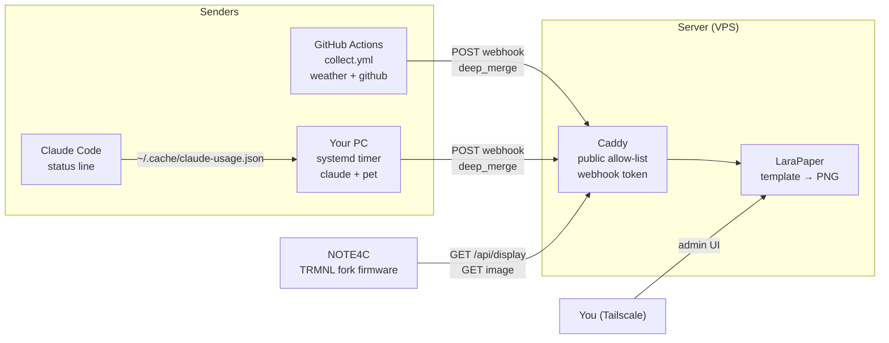

# Architecture

## Pieces

| Directory | What it does | Runs on |
|---|---|---|
| `firmware/trmnl/` | Wakes up, fetches the image, shows it, sleeps. A git subtree of the TRMNL firmware with NOTE4C fixes | the device |
| `server/larapaper/` | Renders `templates/dashboard.liquid` with the pushed data into a 400×300 PNG; serves the device API | laptop today, VPS next |
| `collector/` | Gathers data (sources) and pushes it (sinks) | GitHub Actions + your PC |
| `host/` | PC-only parts: the Claude Code usage tap and the systemd timer | your PC |
| `schema/` | The data contract between the collector and the template | – |
| `docs/` | Hardware notes, flashing, device API, deployment | – |

## Two contracts

1. **Device ↔ server:** [`device-api.md`](device-api.md). The firmware depends only on this.
   Our own server must implement it before it can replace LaraPaper.
2. **Senders ↔ template:** [`schema/dashboard.schema.json`](../schema/dashboard.schema.json). The
   collector's tests check that what it produces matches the schema. The template reads the same keys.

As long as both contracts hold, each piece can change on its own: a new server, a new data
source, a redesigned template.

## Why the data is split between senders

- **GitHub Actions** handles weather and GitHub. They need nothing from your PC, so the screen
  stays fresh while the laptop is off.
- **Your PC** handles the Claude Code usage, which exists only in your local status line, and the
  pet photo, which stays private.
- LaraPaper's `deep_merge` lets each sender update only its own keys. A failed source is left
  out of the payload, so the screen keeps showing that section's last good value.

## Planned

- **Own server:** a new `server/<name>/` implementing the device API, plus a matching
  `collector/src/zectrix_collector/sinks/<name>.py`. LaraPaper can stay until it's ready.
- **Microphone and other device features:** firmware changes in `firmware/trmnl/`, new
  endpoints documented in `device-api.md`, and server support in the same PR.
